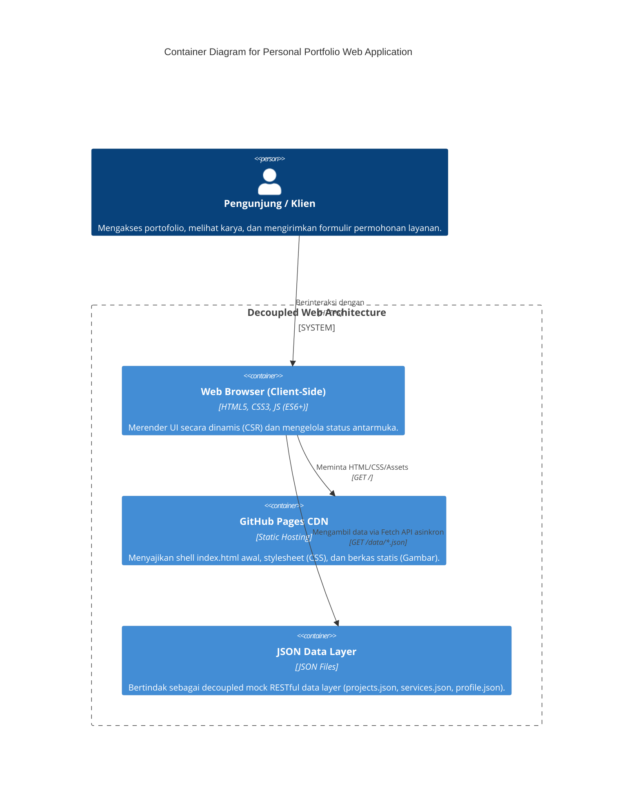

# Portofolio Pribadi & Sistem Layanan (Decoupled Architecture)

Repositori ini berisi tugas mandiri praktikum **Pemrograman dan Pengujian Web (PPW) Minggu ke-4**. Proyek ini merupakan kelanjutan dari hasil kerja pada praktikum Minggu ke-3, di mana arsitektur web yang sebelumnya bersifat monolitik statis telah ditransformasi menjadi arsitektur kontemporer *Decoupled Multi-Tier* menggunakan pendekatan **Dynamic Client-Side Rendering (CSR)**.

## 🔗 Tautan Live Deployment (GitHub Pages)

**Tautan Akses:** [https://boyharendy.github.io/ppw-2026-week2_12S24016/](https://boyharendy.github.io/ppw-2026-week2_12S24016/)

---

## 🏗️ Arsitektur Sistem C4 (Container Model)

Berikut adalah pemodelan arsitektur aplikasi ini yang menunjukkan pemisahan (*Separation of Concerns*) antara *Presentation Tier* (Klien), *Static Hosting*, dan *Data Providers*.

### Analisis Pemisahan Minat (*Separation of Concerns*)
Peralihan dari arsitektur monolitik statis ke *decoupled* memisahkan tanggung jawab sistem menjadi beberapa *tier* terisolasi:
1. **Presentation Tier (Browser/Client):** Diatur oleh `app.js`, HTML shell, dan CSS. Bertanggung jawab murni pada presentasi, manipulasi DOM, dan pengelolaan UI States (Loading, Error, Success).
2. **Service / API Logic Tier:** Diatur oleh `api-service.js` yang menyimulasikan gerbang (gateway) asinkron untuk mengambil data maupun mem-post formulir.
3. **Data Layer (JSON Providers):** Data *hardcoded* dicabut dan dipindahkan ke JSON murni, membuat komponen data sepenuhnya terpisah dari tampilan. Jika ke depannya digunakan REST API asli dari *backend server* (misal: Node.js/PHP), UI klien tidak perlu banyak berubah.

---

## ⚖️ Komparasi: Sebelum vs Sesudah Refactoring

| Aspek Komparasi | Sebelum (Minggu 3: Monolitik Statis) | Sesudah (Minggu 4: Decoupled CSR) |
| :--- | :--- | :--- |
| **Penyimpanan Data** | Tergabung (*hardcoded*) di dalam file HTML. | Terpisah di dalam direktori `/data` sebagai file JSON. |
| **Rendering Konten** | *Server-Side* statis (dikirim utuh dari server). | *Client-Side Rendering (CSR)* dimuat asinkron menggunakan JS. |
| **Elemen Modal** | Duplikasi puluhan baris kode HTML untuk setiap *modal* proyek. | **Hanya 1 (satu)** *Universal Dynamic Modal*, data diinjeksi via JS. |
| **Pengiriman Form** | *Full page reload* (sinkron). | AJAX / Fetch Asinkron tanpa memuat ulang halaman (*No reload*). |
| **Feedback Pengguna** | Bawaan peramban atau *alert* standar. | Visual Toast Bootstrap 5 dinamis dan status *spinner* memuat. |
| **Manajemen Status** | Tidak ada persistensi riwayat lokal. | Menyimpan data pemesanan secara persisten di `localStorage`. |

---

## ⚡ Pengukuran Performa Jaringan (Network Profiling DevTools)

Tabel berikut menunjukkan hasil pengujian profil jaringan (Network tab) menggunakan peramban DevTools (kondisi: Disable Cache vs caching aktif).

| Metrik Jaringan | Cold Load (Disable Cache / Cache Kosong) | Warm Load (Cache Tersimpan) |
| :--- | :--- | :--- |
| **Status HTTP File Statis** | `200 OK` (Mengunduh seluruh berkas) | `304 Not Modified` atau `(from memory/disk cache)` |
| **Waktu Pemuatan (Load Time)** | [Isi ms/s, contoh: ~850 ms] | [Isi ms/s, contoh: ~150 ms] |
| **Total Payload Data Transfer** | [Isi MB/KB, contoh: 2.1 MB] | [Isi MB/KB, contoh: ~25 KB] |
| **Time to First Byte (TTFB)** | [Isi ms, contoh: 45 ms] | [Isi ms, contoh: 2 ms] |

### Analisis HTTP 304 Not Modified & Caching
Pada kondisi *Warm Load*, server (GitHub Pages) tidak perlu mengirim ulang seluruh isi berkas statis (seperti gambar dan pustaka CSS). Server cukup mengirimkan status **`304 Not Modified`** karena sidik jari berkas (`ETag`) di peramban klien masih sama dengan yang ada di server. Hal ini secara drastis menghemat pemakaian *bandwidth* dan mempercepat *rendering*.

### 📷 Screenshot Diagram Waterfall DevTools
*Silakan ganti/tambahkan gambar screenshot Waterfall peramban DevTools Anda di bawah ini:*

 
*(Ganti gambar ini dengan tangkapan layar asli Anda dan hapus tulisan ini)*

---
*Dikerjakan untuk memenuhi capaian pembelajaran Praktikum Pemrograman Web (PPW).*
